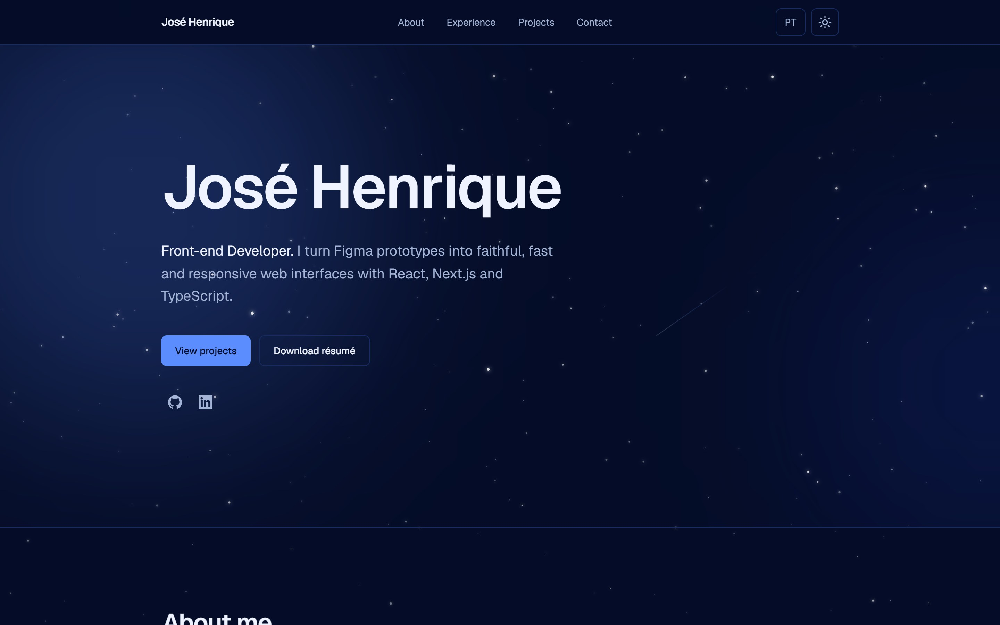
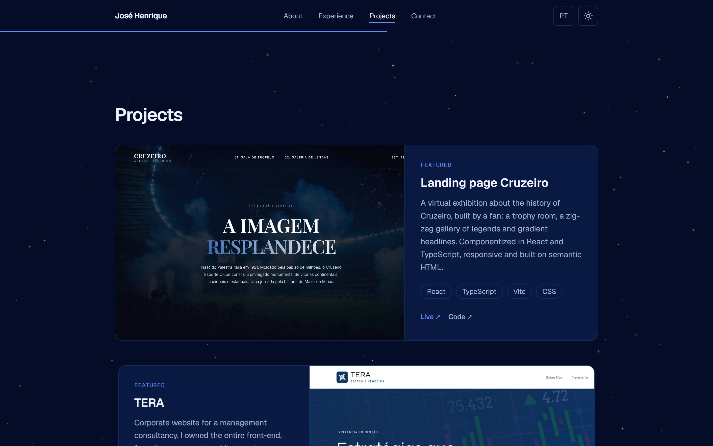
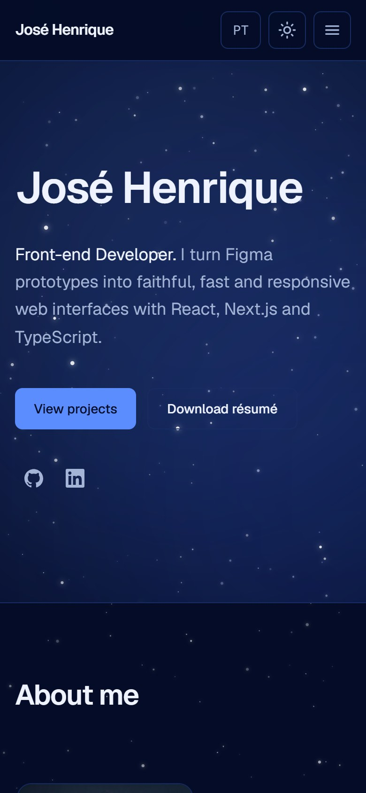
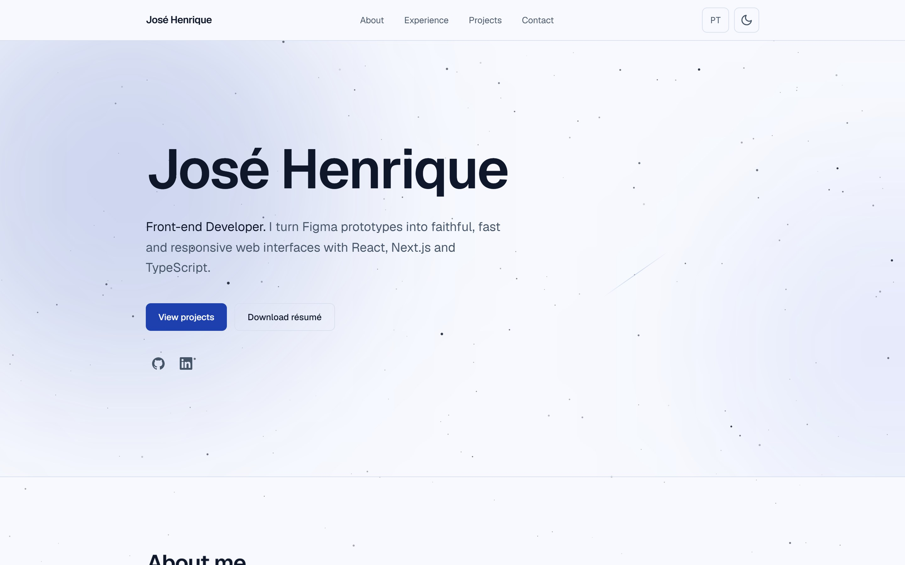

<div align="center">

# José Henrique — Portfolio

**Front-end developer portfolio, built from scratch with Next.js 16, React 19, TypeScript and Tailwind CSS v4.**

A bilingual (🇧🇷 PT / 🇺🇸 EN), accessible and fast single-page site with a starry night sky inspired by Cruzeiro's royal blue.


<br />



</div>

---

## ✨ Highlights

- **Bilingual with native Next.js i18n** — `/pt` and `/en` routes, JSON dictionaries and a `proxy.ts` that sends visitors to their browser's language. No i18n library.
- **Dark and light themes** that cross-fade smoothly with the **View Transitions API**, and remember the visitor's choice.
- **A cinematic hero** — three star layers with mouse and scroll **parallax**, occasional **shooting stars**, a breathing nebula glow and the name revealed letter by letter.
- **Scroll-driven animations in pure CSS** (`animation-timeline: view()` / `scroll()`) — sections slide in, the experience timeline draws itself and a reading-progress bar fills under the header. **Zero JavaScript.**
- **3D project cards** that tilt toward the mouse, with a slow screenshot zoom.
- **Scroll spy navigation** — the header highlights the section on screen (`IntersectionObserver`).
- **Copy-to-clipboard** email button with an animated check mark.
- **Generated share images** (Open Graph) per language, built with `next/og` and the Geist font.
- **Custom 404 page**, favicon and app icons, `robots.txt`, `sitemap.xml` and `hreflang` alternates.

## 📸 Screenshots

<table>
  <tr>
    <td width="66%"></td>
    <td width="34%"></td>
  </tr>
  <tr>
    <td colspan="2"></td>
  </tr>
</table>

## ♿ Accessibility & performance

Accessibility and speed were requirements from day one, not a final pass.

| | Performance | Accessibility | Best Practices | SEO |
|---|:---:|:---:|:---:|:---:|
| 💻 Desktop | **100** | **100** | **100** | **100** |
| 📱 Mobile | **95** | **100** | **100** | **100** |

<sub>Lighthouse 12, production build. Mobile uses Lighthouse's simulated slow 4G.</sub>

- Every animation respects **`prefers-reduced-motion`**: the hero stays still, nothing slides in and the theme switches instantly.
- **"Skip to content" link**, visible focus rings on every control and **24×24 px minimum touch targets** (WCAG 2.2).
- Semantic HTML: one `<h1>`, ordered headings, labelled landmarks and icon buttons with accessible names.
- Scroll reveals slide in without fading, so the contrast of the content is always the real one.
- The whole page weighs **~320 KB**, with **zero layout shift** (CLS 0). Images go through `next/image` with explicit `sizes`, and the hero copy is visible at first paint.
- Security headers (`X-Frame-Options`, `X-Content-Type-Options`, `Referrer-Policy`, `Permissions-Policy`) and no `X-Powered-By`.

## 🧠 Technical decisions

**Native i18n over a library.** Next.js 16 can read the locale anywhere on the server with `next/root-params`, so `getDictionary()` needs no arguments and no provider. The dictionaries never reach the client bundle.

**CSS before JavaScript.** Scroll reveals, the timeline, the progress bar and the copy check are plain CSS. JavaScript is used only where the browser can't do it alone: the hero parallax (batched with `requestAnimationFrame`), the 3D tilt and the scroll spy.

**Typed content, separate from components.** Experience and projects live in typed `data/*.ts` files, with a `Localized` type (`{ pt; en }`) for every translated string. Adding a project is adding an object, not editing markup.

**Server Components by default.** Only the pieces that need state or browser APIs are Client Components (theme toggle, mobile menu, copy button, tilt card, hero sky, scroll spy).

**A deterministic sky.** The stars come from a seeded random generator (seed `1921`, the year Cruzeiro was founded), so the server and the browser render the exact same sky, with no hydration mismatch.

## 🛠️ Tech stack

| Area | Tools |
|---|---|
| Framework | Next.js 16 (App Router, Turbopack), React 19 |
| Language | TypeScript |
| Styling | Tailwind CSS v4 (design tokens in `@theme`) |
| Theme | next-themes + View Transitions API |
| Images | `next/image`, `next/og` |
| Quality | ESLint, Lighthouse |
| Hosting | Vercel |

## 📁 Project structure

```
app/
├── [locale]/            # /pt and /en: layout, page and share image
├── global-not-found.tsx # 404 for any unknown URL
├── robots.ts, sitemap.ts
└── globals.css          # design tokens, keyframes, scroll-driven effects
components/
├── layout/              # Header, Footer, NavLinks, MobileMenu, LanguageSwitcher...
├── sections/            # Hero (+ HeroSky), About, Experience, Projects, Contact
└── ui/                  # Button, Section, Tag, TiltCard, ThemeToggle, Starfield...
data/                    # typed content: experience, projects, stack, socials
messages/                # pt.json and en.json dictionaries
lib/                     # getDictionary, site URL, seeded random, cn()
proxy.ts                 # redirects / to /pt or /en by Accept-Language
```

## 🚀 Running locally

Requires **Node.js 20.9+**.

```bash
git clone https://github.com/jose-oliveirac/portfolio.git
cd portfolio
npm install
npm run dev
```

Open [http://localhost:3000](http://localhost:3000) and you will be redirected to `/pt` or `/en`.

| Command | What it does |
|---|---|
| `npm run dev` | Development server with hot reload |
| `npm run build` | Production build |
| `npm run start` | Serves the production build |
| `npm run lint` | Runs ESLint |

No environment variables are needed. In production, the site URL used by the sitemap, canonical tags and share image comes from Vercel's `VERCEL_PROJECT_PRODUCTION_URL`, or from `NEXT_PUBLIC_SITE_URL` if set.

## 📬 Contact

- **Email:** [jhenriquedevelop@gmail.com](mailto:jhenriquedevelop@gmail.com)
- **LinkedIn:** [linkedin.com/in/josehdev](https://www.linkedin.com/in/josehdev)
- **GitHub:** [github.com/jose-oliveirac](https://github.com/jose-oliveirac)

---

<div align="center">
<sub>Designed and built by José Henrique · © 2026 · All rights reserved</sub>
</div>
